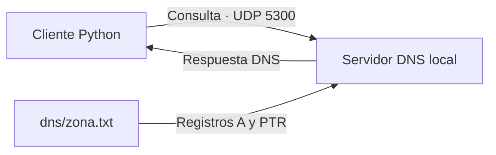

# Laboratorio de resolución DNS local

**Rafael Escudero** · Universidad Tecnológica de Panamá · Portafolio de Sistemas Colaborativos

## Objetivo

Configurar un servidor DNS de práctica y verificar tres respuestas: una dirección IPv4 a partir de un nombre, un nombre a partir de una dirección IPv4 y un error cuando se consulta un nombre inexistente.

## Topología



El cliente y el servidor se ejecutan en el mismo equipo. El servidor escucha en `127.0.0.1:5300` y consulta los registros del archivo [dns/zona.txt](dns/zona.txt). La IP `192.0.2.10` es un valor de ejemplo reservado para documentación.

| Tipo | Consulta | Respuesta prevista |
| --- | --- | --- |
| A | `servidor.lab.test.` | `192.0.2.10` |
| PTR | `10.2.0.192.in-addr.arpa.` | `servidor.lab.test.` |
| A | `inexistente.lab.test.` | `NXDOMAIN`, sin registros |

## Procedimiento

Necesitas Python 3 y dos terminales abiertas en la carpeta `utp-dns-lab`.

**Linux o macOS**

1. En la primera terminal, crea un entorno de Python, instala la dependencia e inicia el servidor.

   ```bash
   python3 -m venv .venv
   .venv/bin/python -m pip install -r requirements.txt
   .venv/bin/python -m dnslib.zoneresolver -a 127.0.0.1 -p 5300 -z dns/zona.txt
   ```

2. Deja el servidor activo. En la segunda terminal, ejecuta el verificador y haz una consulta manual para ver los campos de la respuesta.

   ```bash
   .venv/bin/python verificar.py
   .venv/bin/python -m dnslib.client servidor.lab.test. A -s 127.0.0.1:5300
   ```

**Windows (PowerShell)**

1. En la primera terminal, inicia el servidor.

   ```powershell
   py -3 -m venv .venv
   .\.venv\Scripts\python.exe -m pip install -r requirements.txt
   .\.venv\Scripts\python.exe -m dnslib.zoneresolver -a 127.0.0.1 -p 5300 -z dns/zona.txt
   ```

2. En la segunda terminal, ejecuta el verificador y la consulta manual.

   ```powershell
   .\.venv\Scripts\python.exe verificar.py
   .\.venv\Scripts\python.exe -m dnslib.client servidor.lab.test. A -s 127.0.0.1:5300
   ```

Si Python está disponible como `python` en Windows, puedes usar `python -m venv .venv` en el primer comando. Al finalizar la práctica, presiona **Ctrl+C** en la terminal del servidor.

## Resultados

La [ejecución de referencia](docs/pruebas-dns.txt) obtuvo **3 de 3 pruebas correctas**. El verificador compara el código de estado y los registros de respuesta. El registro **A** devuelve la IPv4 y el registro **PTR** devuelve el nombre. **NXDOMAIN** indica que el servidor respondió que el nombre consultado no existe en los datos de esta práctica.

La práctica comprueba resolución de nombres. La IP de ejemplo identifica un valor dentro del registro A. Para demostrar conectividad con un equipo se necesitaría una prueba de red adicional con una dirección asignada al equipo.

## Archivos

| Archivo | Función |
| --- | --- |
| [dns/zona.txt](dns/zona.txt) | Registros que carga el servidor local |
| [verificar.py](verificar.py) | Consultas de prueba con validación de respuestas |
| [requirements.txt](requirements.txt) | Versión de la dependencia del laboratorio |
| [docs/index.html](docs/index.html) | Página del portafolio para GitHub Pages |
| [docs/pruebas-dns.txt](docs/pruebas-dns.txt) | Evidencia de la ejecución de referencia |
| [LICENSE](LICENSE) | Licencia MIT del repositorio |

## Referencias

- [Documentación de dnslib 0.9.26](https://pypi.org/project/dnslib/0.9.26/)
- [RFC 2606 sobre nombres DNS reservados](https://www.rfc-editor.org/rfc/rfc2606)
- [RFC 5737 sobre direcciones IPv4 de documentación](https://www.rfc-editor.org/rfc/rfc5737)
